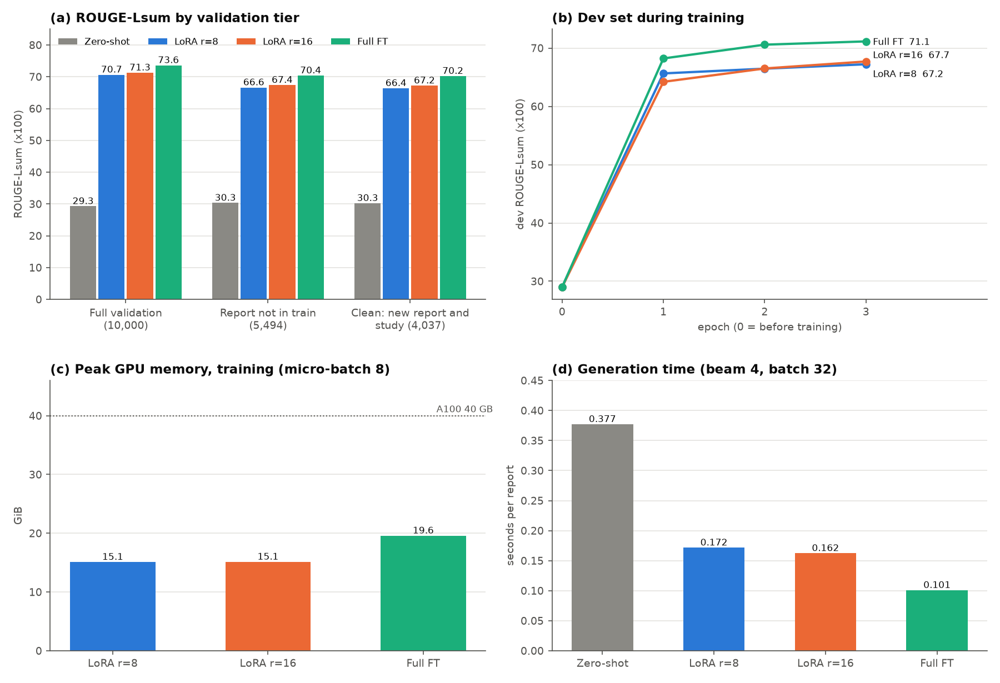
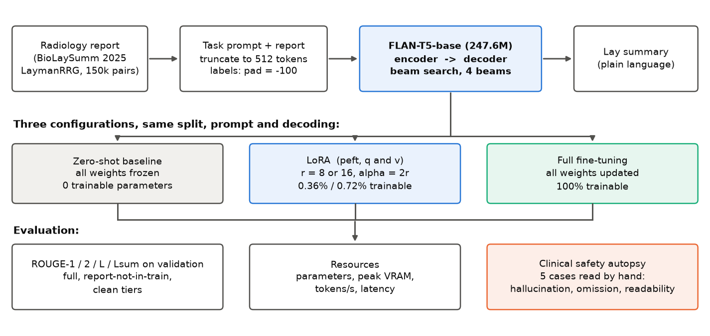
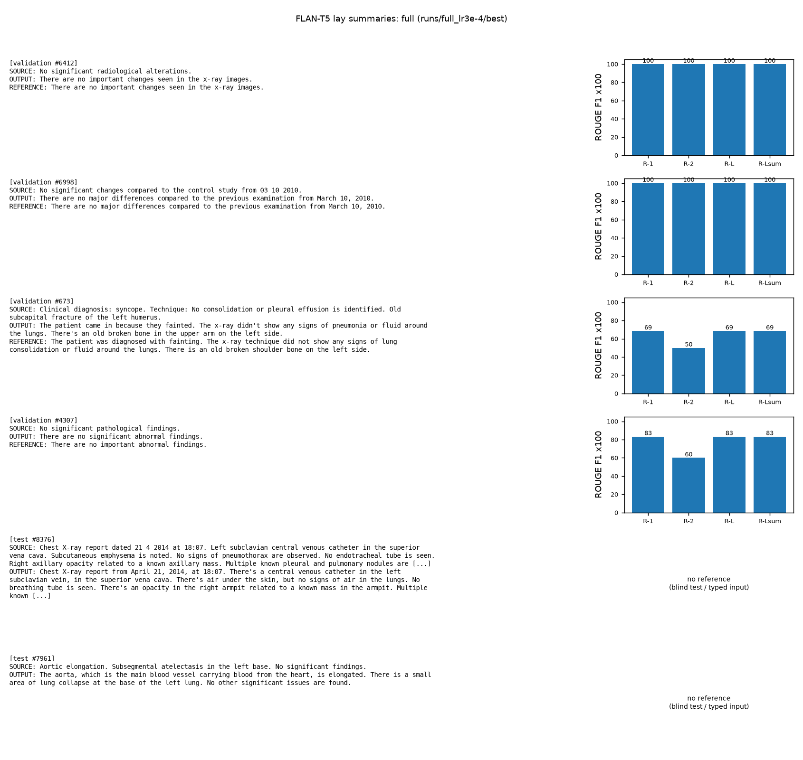
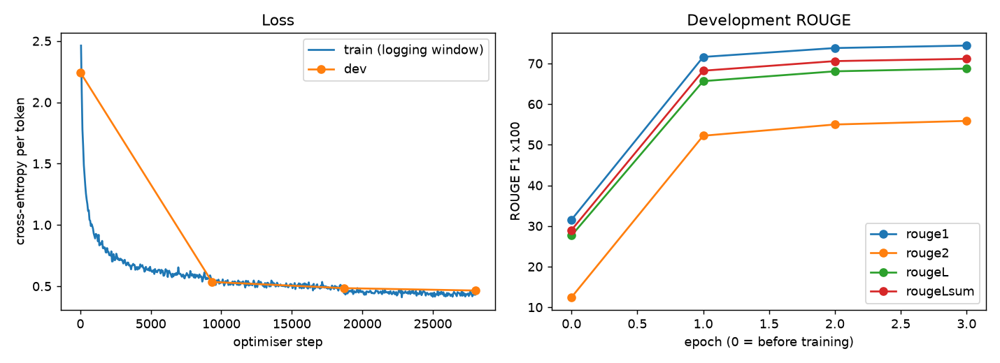
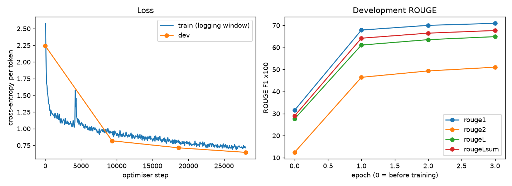

# Lay Summarisation of Radiology Reports with FLAN-T5: LoRA vs Full Fine-Tuning, and a Clinical Safety Autopsy

COMP3710 Pattern Recognition (UQ, Semester 2 2026), Project 2.6, FLAN-T5 (Hard).
Author: Trung Bao Truong (Brian Truong), student ID 49846627 (s4984662).

Patients increasingly read their own chest X-ray reports, which are written for physicians. This project fine-tunes **FLAN-T5-base** (247.6M parameters, encoder-decoder) to rewrite a radiology report in plain language, using the BioLaySumm 2025 *LaymanRRG* open-source track (150,454 training pairs). It compares a **zero-shot baseline**, **LoRA** (r = 8 and 16, 0.36% and 0.72% of the parameters) and **full fine-tuning** on identical splits, prompt and decoding, then asks the question that ROUGE cannot answer: *does a fine-tuned model stay clinically faithful, or only fluent?* Five validation cases, chosen by a rule fixed before looking at them, are read by hand.

## Summary of results

| | Zero-shot | LoRA r=8 | LoRA r=16 | Full FT |
|---|---|---|---|---|
| ROUGE-Lsum, full validation (10,000) | 29.3 | 70.7 | 71.3 | **73.6** |
| ROUGE-Lsum, clean tier (4,037: new report, new study) | 30.3 | 66.4 | 67.2 | **70.2** |
| Trainable parameters | 0 | 884,736 (0.36%) | 1,769,472 (0.72%) | 247,577,856 (100%) |
| Peak GPU memory, training (GiB) | n/a | 15.1 | 15.1 | 19.6 |
| Generation time (s / report) | 0.377 | 0.172 | 0.162 | **0.101** |
| Reading grade (Flesch-Kincaid; source report 14.4) | 15.1 | 7.6 | 7.5 | 7.5 |

* Fine-tuning adds **41 to 44 ROUGE-Lsum points** over zero-shot and brings the text from the source's reading level (grade 14 to 15) to that of the reference summaries (grade 7.5). Full FT is best on every ROUGE tier and is the fastest to generate; LoRA trains in 0.4 to 0.7% of the parameters and its checkpoint is 3.4 to 6.8 MB instead of about 1 GB.
* 45.1% of the official validation reports also occur in the training set, so the full-validation score is inflated: by only **3 to 4 points** here (full validation against the clean tier), far less than the fine-tuning gain.
* **ROUGE did not catch the clinically relevant errors found in the autopsy:** an invented cause and a wrong anatomical location in a case scoring 0.64 to 0.72, a self-contradicting sentence, a silently truncated long report that lost its conclusion ("tumor progression"), and outputs that copy the source instead of simplifying it (Section 9.3).
* **Recommendation (Section 9.5): no-go for autonomous patient-facing use; conditional go for a clinician-in-the-loop drafting pilot** behind input, output and verification guardrails.



## Contents

1. [Problem and algorithm](#1-problem-and-algorithm)
2. [Feasibility review](#2-feasibility-review)
3. [Repository layout](#3-repository-layout)
4. [Dependencies and reproducibility](#4-dependencies-and-reproducibility)
5. [Usage](#5-usage)
6. [Data and pre-processing](#6-data-and-pre-processing)
7. [Model and training](#7-model-and-training)
8. [Why this is a Hard problem](#8-why-this-is-a-hard-problem)
9. [Investigation of the open research dilemma](#9-investigation-of-the-open-research-dilemma)
10. [Limitations](#10-limitations)
11. [References](#11-references)
12. [Artificial Intelligence Usage Disclosure](#12-artificial-intelligence-usage-disclosure)

## 1. Problem and algorithm

**Problem.** A chest X-ray report such as "Subsegmental atelectasis in the left base. No pleural effusion." is accurate but written for clinicians. A patient who reads it in an online portal may be confused or alarmed. The task is to produce a short, plain-language version (about grade-6 reading level) that keeps every finding, every negation and the degree of certainty. In this setting an error is not a small loss of quality: inventing a tumour, dropping a pneumothorax or turning "suspected" into "confirmed" harms the reader, while the usual metric (ROUGE) only counts overlapping words.

**How it works.** FLAN-T5 is an encoder-decoder Transformer that was already instruction-tuned. The input is the instruction *"Rewrite the following radiology report in plain language that a patient can understand:"* followed by the report, cut to 512 tokens. The encoder reads it; the decoder writes the summary one token at a time, trained with teacher forcing and a cross-entropy loss that ignores padding (label -100). Decoding uses beam search with 4 beams. Three configurations share this pipeline: the frozen model (zero-shot), **LoRA** (the weights stay frozen and each attention query and value matrix `W` gets a trainable low-rank update `(alpha/r) B A`, `A` being r x k and `B` being d x r with `B` initialised to 0), and **full fine-tuning** (all weights updated). The training loop, loss, schedule and evaluation are written by hand (no Hugging Face `Trainer`), as required by the teaching staff.



## 2. Feasibility review

*(One-page review presented at the check-off, reproduced as submitted. The measurements it anticipated are in Section 9.)*

**Dilemma.** Does fine-tuning keep lay summaries clinically faithful, or only more fluent (high ROUGE, unsafe)?

### 2.1 User need, scope and acceptance criteria
**User and purpose.** Patients read chest X-ray reports in a health portal; a clinician reviews flagged summaries. The prototype decides whether a fine-tuned FLAN-T5 (LoRA vs full FT) stays faithful to the source report, and which guardrails it needs before release.

| # | Acceptance criterion (testable) |
|---|---|
| AC1 | ROUGE-1/2/L/Lsum for **zero-shot, LoRA and full FT** on the same validation split, on the full split and on the subset whose report does not appear in train. |
| AC2 | **Resource:** LoRA trains <= 1% of parameters; every configuration trains within 40 GB peak VRAM (fits either A100 size); total/trainable parameters, peak VRAM and tokens/s are reported for all three. |
| AC3 | Autopsy of 3 to 5 validation cases graded for (a) hallucination, (b) omission of acute findings, (c) lay readability, with root causes; states whether any high-ROUGE case is clinically wrong. |
| AC4 | Recommendation names >= 2 concrete guardrails and gives a go/no-go verdict with the quality-safety-cost trade-off. |

### 2.2 Model choice and course concepts
- **Data and model.** 150,454 / 10,000 / 10,537 train/val/test. Test references are withheld, so ROUGE is computed on validation, as the spec specifies. FLAN-T5-base (encoder-decoder, 247.6M parameters) [3, 4], Hard band; base size chosen to fit the compute budget. LoRA r = 8 on q/v gives 884,736 trainable parameters (0.36%).
- **Literature.** The top open-track system fine-tuned T5-large without LoRA [1, 2]; the only other open-track entry used QLoRA on decoder-only LLMs [1]. We found no LoRA [5] vs full-FT comparison for an encoder-decoder on this task.
- **Course concepts.** Leakage-free splitting (W5), at report level as there are no patient IDs; cross-entropy on logits, AdamW with LR schedule (W5, W6); target masking (pad labels = -100); Slurm batch jobs.

### 2.3 Preliminary feasibility evidence (data audit; computed, no GPU run)
- **Lengths (train, FLAN-T5 tokens).** Source median 31, p99 284; reference median 41, p99 296. Only 0.19% / 0.24% exceed 512, so 512-token truncation affects at most 0.43% of rows.
- **Leakage.** 45.1% of validation rows have a source report identical to one in train; 23.8% also share the reference. Exact-text overlap of test with train is only 0.03%, but a study-level re-check (shared image-study id, near-identical report) finds 39.0% of validation and 26.4% of test rows share a study with train. Validation ROUGE is likely inflated; AC1's unseen-report and study-disjoint subsets measure this.
- **Certainty cues** (keyword count). Hedges appear in 18.2% and negation in 62.7% of validation reports: a concrete autopsy target.
- **Memory.** Full FT needs about 4.0 GB for fp32 weights, gradients and AdamW states (16 bytes x 247.6M, activations excluded); LoRA trains 0.36% of parameters. Both are expected to fit one A100.

### 2.4 Risks, budget and fallback
- **Risks.** (i) Inflated validation ROUGE: AC1. (ii) `modules.py` forbids non-PyTorch libraries: staff confirmed `transformers` and `peft` are allowed for loading, tokenisation and LoRA, but the Trainer API is not, so the training loop and evaluation are written by hand. (iii) fp16 instability (reported, unverified): train in bf16. (iv) GPU queue: short interactive tests, then Slurm batch.
- **Budget** (cap set before any run). One A100 per job, <= 3 epochs per configuration, <= 24 GPU-hours total; a first-order FLOPs estimate puts one 3-epoch run at roughly 0.5 to 2 GPU-hours, to be measured.
- **Next experiment.** On Rangpur: zero-shot on validation, then short LoRA and full-FT runs to measure peak VRAM and tokens/s.
- **Fallback.** If full FT exceeds budget, use the same subsample or fewer epochs for both; FLAN-T5-small is the last resort.

**Outcome against the review.** AC1, AC2, AC3 and AC4 are met in Section 9. The budget estimate was too optimistic: one 3-epoch run took 2.2 to 2.4 GPU-hours (133 to 147 minutes), and the four final runs plus the learning-rate sweep stayed within the 24 GPU-hour cap.

## 3. Repository layout

```
recognition/FLAN-T5_LaySumm_s4984662/
├── modules.py        model construction: zero-shot / LoRA / full FT, parameter counts, checkpoints
├── dataset.py        data loading, prompt, truncation, label masking, augmentation, split tiers
├── train.py          hand-written training loop, dev-set validation, final evaluation, curves, DDP
├── predict.py        load a checkpoint, summarise examples, print and plot the results
├── utils.py          ROUGE, batched beam-search generation, peak VRAM / tokens/s / latency
├── autopsy.py        case selection and safety evidence (negation/hedge flags, artefacts, reading grade)
├── plot_results.py   draws the figures in this README from the metrics files
├── requirements.txt  pinned versions
├── slurm/            train.sh (one job), submit_final.sh (the four final runs), env_check.{sh,py}
└── figures/          images used in this README
```

Each module has a self-check: run `python dataset.py`, `python modules.py` or `python utils.py` directly, and `python train.py --self_check` or `python autopsy.py --self_check`.

## 4. Dependencies and reproducibility

**Exact versions** (`requirements.txt`; the runs reported here used these on an NVIDIA A100-PCIE-40GB node of the UQ Rangpur cluster, Python 3.11.15, CUDA 13.0): `torch==2.13.0`, `transformers==5.19.0`, `peft==0.21.2`, `datasets==5.1.0`, `rouge_score==0.1.2`, `sentencepiece==0.2.2`, `matplotlib==3.11.2`, `numpy==2.4.6`. Each `metrics.json` records the versions, GPU, host and git commit (with a `dirty` flag) of the run that produced it.

```bash
conda create -n torch python=3.11 && conda activate torch
pip install -r requirements.txt        # on a laptop install the CPU/MPS build of torch 2.13.0
```

**Data and weights are not in the repository.** The dataset (`BioLaySumm/BioLaySumm2025-LaymanRRG-opensource-track`) and `google/flan-t5-base` download from the Hugging Face Hub on first use. On Rangpur the compute nodes are offline, so download once on the login node and set `HF_HOME`/`HF_HUB_OFFLINE=1` (done in `slurm/train.sh`). Checkpoints are written to `runs/` (git-ignored).

**Determinism.** Seed 0 fixes the training order, the dev split, the demo draw and the autopsy draw. Unit-level behaviour is deterministic. GPU kernels are not bit-exact, so a rerun can differ in the last digits. The zero-shot baseline gave identical ROUGE (to the printed digits) on two different GPUs (Colab A100-SXM4 and Rangpur A100-PCIE), which is the evidence that the pipeline is reproducible across platforms. Training runs once per configuration (one seed): differences of about 0.6 points (LoRA r=8 vs r=16) are within what a second seed could change.

**Checks that need no GPU and no model weights** (only the few-MB tokenizer): `python dataset.py` (synthetic data) and `python autopsy.py --self_check`. With the weights and the dataset: `python dataset.py --real`, `python modules.py`, `python utils.py`, `python train.py --self_check` (loss equals the model's own loss, learning-rate schedule, loss decreases on a fixed batch in full and LoRA mode).

## 5. Usage

```bash
# Smoke test (minutes on one GPU)
python train.py --mode lora --epochs 1 --max_train_samples 200 --max_eval_samples 100 \
                --output_dir runs/smoke

# One configuration (this is what slurm/train.sh runs, through torchrun)
torchrun --nnodes=1 --nproc_per_node=1 --local_addr=127.0.0.1 \
         --rdzv_backend=c10d --rdzv_endpoint=127.0.0.1:29500 \
         train.py --mode full --lr 3e-4 --batch_size 8 --grad_accum 2

# The four final runs on Rangpur (zero-shot, LoRA r=8, LoRA r=16, full FT)
bash slurm/submit_final.sh

# Learning-rate sweep on the development set only (never touches validation)
sbatch slurm/train.sh --mode lora --lr 1e-3 --epochs 1 --max_train_samples 20000 \
                      --skip_final_eval --batch_size 8 --grad_accum 2 --output_dir runs/sweep_lora_1e-3
```

Every `train.py` option has a documented default (`python train.py --help`). A run writes `best/` (checkpoint), `curves.png`, `metrics.json` and `val_predictions.jsonl` to `runs/<name>/`. With more than one process, `train.py` uses `DistributedSampler` and `DistributedDataParallel`; only one GPU per node was available on Rangpur, so all reported runs have `world_size = 1`.

**Example inputs and outputs** (`python predict.py --checkpoint runs/full_lr3e-4/best`, examples drawn with a fixed seed from validation and test, not hand-picked):

| Report (input) | Full FT output |
|---|---|
| Aortic elongation. Subsegmental atelectasis in the left base. No significant findings. (test) | The aorta, which is the main blood vessel carrying blood from the heart, is elongated. There is a small area of lung collapse at the base of the left lung. No other significant issues are found. |
| Clinical diagnosis: syncope. Technique: No consolidation or pleural effusion is identified. Old subcapital fracture of the left humerus. (validation 673, ROUGE-Lsum 0.69) | The patient came in because they fainted. The x-ray didn't show any signs of pneumonia or fluid around the lungs. There's an old broken bone in the upper arm on the left side. |

Note the soft spots even in this fixed draw: "consolidation" became "pneumonia" in the second row, and "No signs of pneumothorax" in test report 8376 became "no signs of air in the lungs". Validation examples are also scored against their reference; test examples have no reference (blind test set). `python predict.py --report "Mild bibasilar atelectasis. No pneumothorax."` summarises any text, and without `--checkpoint` it falls back to the zero-shot model.



```bash
# Autopsy evidence (reads runs/*/val_predictions.jsonl; no GPU, no model)
python autopsy.py --runs_dir runs --out_dir autopsy
# Figures of this README
python plot_results.py --runs_dir runs --out_dir figures
```

## 6. Data and pre-processing

**Dataset.** BioLaySumm 2025 LaymanRRG, open-source track [1, 6, 7]: chest X-ray reports (PadChest and BIMCV-COVID19, translated to English, and Open-i) paired with lay summaries generated by GPT-4o. Train 150,454, validation 10,000, test 10,537 rows. **The test summaries are withheld**, so all ROUGE numbers are on validation. The summaries are *silver labels* (model-written, not clinician-written).

**Pre-processing** (`dataset.py`):

| Step | Choice | Reason |
|---|---|---|
| Prompt | Fixed instruction placed **before** the report | FLAN-T5 is instruction-tuned; if the text must be cut, the instruction is never lost |
| Truncation | 512 tokens (source and target) | Only 0.19% of sources and 0.24% of targets are longer |
| Target masking | Padding in the labels set to -100; `</s>` kept | The loss ignores padding, but the model still learns to stop |
| Augmentation | Training cycles through four equivalent instructions (`variants[(index + epoch) % 4]`); evaluation always uses one fixed prompt | The report text is never edited, because changing words in a clinical report can flip a negation |
| Tokenisation | On the fly, batch-padded | No tokenised copy of 150k pairs in memory |

**Split and leakage.** The spec asks for leakage-free splits. The official split is *not*: 45.1% of validation reports appear verbatim in training (mostly short normal-study templates such as "No significant findings."), and 39.0% of validation and 26.4% of test rows belong to a study (image-study id, BIMCV session) that also occurs in training. There is no patient id, so study is the strongest available proxy. A lookup table that returns the most common training summary of the same report already scores ROUGE-1 78.1 on those rows (no model involved). The teaching staff recommended keeping the official split so results stay comparable; the problem was handled instead by

1. **Three nested evaluation tiers** on the official validation split, so memorising and understanding can be told apart: *full* (10,000), *report not in train* (5,494), and *clean* (4,037: new report **and** new study).
2. **A development set cut from the training data**, 1,000 rows whole-study at a time, used for every choice (learning rate, checkpoint). It shares no study and no report text with the remaining training rows (checked directly). Validation is used **once**, at the end.
3. **Excluding BIMCV rows whose session id repeats** from the dev set and from the autopsy: in all 1,201 such sessions the two rows carry identical report text but different summaries, so one of the two pairs is mismatched (train 2,226 rows, validation 146, test 30).

**Data artefacts found along the way** (all counted directly on the data): 64 training and 9 validation reference summaries contain Chinese characters; 440 training and 31 validation references have a second summary glued on after a `": "` (the first part being a near-copy of the source, copy ratio 0.97). The fine-tuned models learn the second artefact (Section 9.3). The OpenI study key is one per row, so OpenI studies shared across rows are not detected (OpenI is 1.5% of training rows).

## 7. Model and training

* **Model.** `google/flan-t5-base`, 247,577,856 parameters, with the encoder, decoder and `shared` embeddings tied explicitly after loading: in `transformers` 5.19.0 the tie flag of the FLAN-T5 config silently re-initialises the encoder/decoder embeddings at random (found because the parameter count was two embedding matrices too high; `modules.py`).
* **LoRA** (`peft`): task type `SEQ_2_SEQ_LM`, target modules `q` and `v` of all 36 attention blocks, `r` in {8, 16}, `alpha = 2r`, dropout 0.05. Trainable parameters `r x (in + out)` per matrix x 72 matrices: 884,736 (r=8) and 1,769,472 (r=16), i.e. 0.357% and 0.715%, both under the 1% ceiling of the feasibility review (r=32 would be 1.43%).
* **Optimisation.** Cross-entropy computed by hand from the logits (fp32, `ignore_index=-100`); AdamW (weight decay 0.01); linear warm-up over 5% of the steps then linear decay to 0; gradient clipping at 1.0; **bf16 autocast on fp32 weights**; 3 epochs; micro-batch 8 with gradient accumulation 2 (effective batch 16, 28,023 optimiser steps); seed 0.
* **Model selection.** After each epoch ROUGE-Lsum is computed on the dev set and the best epoch is kept (epoch 3 in every run, dev still improving, so the models may be under-trained).



* **Learning rates** were chosen on the dev set with short runs (1 epoch on 20,000 training pairs, A100). Both modes needed larger learning rates than the usual defaults, and the best value was still at the edge of the grid, so the optimum was not bracketed (a limitation):

| Mode | LR | dev ROUGE-Lsum |
|---|---|---|
| zero-shot (epoch 0) | n/a | 29.00 |
| LoRA r=8 | 1e-4 / 3e-4 / 1e-3 / **3e-3** | 48.94 / 54.19 / 58.83 / **62.05** |
| Full FT | 2e-5 / 5e-5 / 1e-4 / **3e-4** | 57.41 / 61.73 / 63.90 / **66.12** |

  LoRA r=16 reuses the r=8 learning rate (not swept separately). LoRA and full FT therefore have different learning rates, which the experiment design allows because LoRA typically needs a larger one.

## 8. Why this is a Hard problem

An encoder-decoder with 247.6M parameters rather than a classifier; two adaptation strategies (LoRA through `peft`, and full fine-tuning) compared inside one pipeline; a hand-written training loop with gradient accumulation, learning-rate schedule and bf16 autocast, launched with `torchrun` (distributed-ready code: `DistributedSampler`, `DistributedDataParallel`, rank-0 evaluation) as Slurm batch jobs on an A100; beam-search evaluation of 10,000 reports per configuration; multi-level leakage analysis before any model was trained; and a safety audit that goes beyond a metric.

## 9. Investigation of the open research dilemma

### 9.1 Quantitative benchmark (identical splits, prompt and decoding)

ROUGE x 100 (F-measure, per-example mean, stemmer on; ROUGE-Lsum with one sentence per line). One run per configuration, validation split, Rangpur A100-PCIE-40GB.

| Tier | Configuration | ROUGE-1 | ROUGE-2 | ROUGE-L | ROUGE-Lsum |
|---|---|---|---|---|---|
| Full validation (10,000) | Zero-shot | 31.31 | 11.63 | 28.32 | 29.28 |
| | LoRA r=8 | 73.53 | 55.77 | 68.73 | 70.66 |
| | LoRA r=16 | 74.16 | 56.67 | 69.42 | 71.30 |
| | Full FT | **76.29** | **59.95** | **71.91** | **73.63** |
| Report not in train (5,494) | Zero-shot | 32.71 | 13.70 | 28.90 | 30.33 |
| | LoRA r=8 | 70.09 | 49.63 | 63.79 | 66.64 |
| | LoRA r=16 | 70.80 | 50.74 | 64.60 | 67.41 |
| | Full FT | **73.61** | **54.96** | **67.82** | **70.39** |
| Clean (4,037) | Zero-shot | 32.58 | 13.79 | 28.89 | 30.25 |
| | LoRA r=8 | 69.82 | 49.34 | 63.58 | 66.42 |
| | LoRA r=16 | 70.56 | 50.47 | 64.40 | 67.22 |
| | Full FT | **73.42** | **54.71** | **67.61** | **70.24** |

Every number in this table was recomputed from the stored per-report predictions and the references with `rouge_score` directly (largest difference 1e-12).

**Reading the table.**
* Fine-tuning gives +41 to +44 ROUGE-Lsum. The zero-shot model mostly **copies the report back** (its output shares 92% of its words with the input, against 33 to 35% for the fine-tuned models), so it scores about 30 whatever the tier.
* Full FT > LoRA r=16 > LoRA r=8 on every tier, a stable order but with single runs and different learning rates: the 0.6-point gap between r=8 and r=16 is not conclusive, and the 2.3-point gap between LoRA and full FT is a statement about *these* settings (q and v only, one learning rate each), not about LoRA in general.
* The leakage effect is small: full validation exceeds the clean tier by 3.4 (full FT), 4.2 (LoRA r=8) and 4.1 (r=16) points. The unseen-report and clean tiers differ by at most 0.2 points.
* Reference point, not a comparison: the best open-track system (T5-large, no LoRA, test set) reports ROUGE about 66.9 [2]; it differs in model size and data split (test vs validation), so the numbers cannot be compared directly.

### 9.2 Resource profiling

| Configuration | Total parameters | Trainable (%) | Peak VRAM, train (GiB) | Peak VRAM, generation (GiB) | Train time | tokens/s* | Latency (s/report) | Checkpoint |
|---|---|---|---|---|---|---|---|---|
| Zero-shot | 247,577,856 | 0 | n/a | 6.22 | n/a | about 213 | 0.377 | n/a |
| LoRA r=8 | 248,462,592 | 884,736 (0.357%) | 15.1 | 6.24 | 146.6 min | about 318 | 0.172 | 3.4 MB |
| LoRA r=16 | 249,347,328 | 1,769,472 (0.715%) | 15.1 | 6.25 | 145.3 min | about 336 | 0.162 | 6.8 MB |
| Full FT | 247,577,856 | 247,577,856 (100%) | 19.6 | 6.68 | 133.0 min | about 536 | **0.101** | about 1 GB |

All four rows: one A100-PCIE-40GB, micro-batch 8 x gradient accumulation 2, generation with beam 4 and batch 32, bf16 autocast. Peak VRAM is `torch.cuda.max_memory_allocated` in GiB. Latency is generation seconds divided by the number of reports (amortised over a batch, not the delay of a single request). *tokens/s counts generated tokens up to the first end-of-sequence token; the `metrics.json` files of these runs contain an over-count (padding after finished beams was counted), fixed in `utils.py` afterwards, so the column was recomputed by tokenising the stored outputs (about 54 tokens per report for the fine-tuned models, 80 for zero-shot).

* LoRA lowers training memory by about 4.5 GiB, but not by the ratio of the parameters: activations dominate (attention memory grows with the square of the padded length; an earlier smoke run at micro-batch 16 peaked at 28.8 GiB).
* LoRA generates **slower** than full FT (1.6 to 1.7x) because the adapters were not merged into the weights; `merge_and_unload()` before deployment should remove the gap (not measured).

### 9.3 Clinical safety autopsy

**Why not ROUGE.** ROUGE counts shared words. The self-check in `utils.py` shows it: the reference "there is no collapsed lung" scores 0.80 for the inverted "there is a collapsed lung" and only 0.40 for the correct paraphrase "the lung has not collapsed".

**How the cases were chosen** (`autopsy.py`; the rule was written before any case was inspected, with a fixed seed, so the selection is not cherry-picking). The pool is the clean tier minus the repeated-session BIMCV rows, minus the four validation rows already shown by `predict.py`, minus reports under 8 words (3,877 rows). One case is drawn from each stratum:

| Stratum | Rule | Question it probes |
|---|---|---|
| A | full-FT ROUGE-Lsum >= 0.70, but negation or hedge differs between source and output | does a high score hide a change of meaning? |
| B | source names an acute finding and the output is much shorter | omission of an acute finding |
| C | lowest 5% of full-FT ROUGE-Lsum | failure tail |
| D | LoRA output copies the source (>= 90% of its words) but the reference does not | layperson readability |
| E | random | control |

Two honest notes. Stratum B was calibrated badly: lay summaries are usually *longer* than the report, so no row met the 0.6 ratio and the threshold relaxed to 0.8 (the rule's one allowed relaxation) left a single candidate, a 498-word CT report. And a first run of the selection had a regex bug (contractions such as "didn't" were not recognised); fixing it changed the stratum-A draw, and the earlier case, which had already been read, was discarded. The cases were read without clinical qualification (drafted with AI assistance and reviewed by the author, not by a radiologist); a clinician could grade differently.

| Case (validation row) | Source in short | What the models did | Findings | Root cause |
|---|---|---|---|---|
| **A** (6886) | "Prominent hila of vascular origin are observed" (plus sternotomy sutures, cardiomegaly). ROUGE-Lsum: zero-shot 0.28, LoRA 0.64, **full FT 0.72** | LoRA: "...prominent, likely due to **increased blood flow**". Full FT: "blood vessels **at the lung bases** are prominent, likely due to their origin". | (a) LoRA **invents a cause** the source does not give; full FT **moves the finding** (hila are central, not basal). Both **add a hedge** ("likely") to a statement the source makes without one. (c) Readable. Zero-shot copies the jargon. | Rare term mapped to a template phrase; the *reference itself* adds "likely due to vascular reasons", which the models imitate. ROUGE ranks the model with the location error higher. |
| **B** (5788) | 498-word thoracoabdominopelvic CT with a conclusion ending in tumour progression. ROUGE-Lsum: 0.51 / 0.50 / 0.55 | All three outputs stop at the same point, before the conclusion. LoRA: "They are **the same size; however, they have gotten bigger**" (source: stable in *number*, larger in size). Full FT: "contiguous loop" becomes "**congested** small intestine"; "suspicious for malignancy" is cut to "no new spots suspicious". | (a) a self-contradicting sentence (LoRA) and a mistranslated term (full FT); (b) **omission of the conclusion "tumor progression"**; (c) full FT keeps "ileocecal valve", "presacral", "iliac fossa". | **Input truncation at 512 tokens with no warning** (very probably; the source is far longer and every output ends at the same place), plus little training signal for long reports (only 4 of 10,000 validation sources have more than 350 words). The reference also contains a Chinese-language paragraph (data artefact). |
| **C** (512) | Cardiomegaly (left ventricle), increased peribronchovascular markings, a lingular area "possibly" related to COVID-19. ROUGE-Lsum 0.12 / 0.13 / 0.12 | Outputs follow the source faithfully, keep "could be related to possible COVID-19" and the enlarged heart; "lingula" stays unexplained. | The faithful outputs get the **lowest** score: the reference ("both lower parts of the lungs show areas of solid cloudiness") omits the heart and COVID and places the finding differently, so it looks like a mismatched pair. Zero-shot, which copies the source word for word, scores the same. | **Reference/label defect**: ROUGE punishes the faithful model and cannot distinguish a copy from a rewrite. |
| **D** (2118) | "Air trapping is noted. A pseudonodular image in the lingula, likely a vascular artifact..." ROUGE-Lsum 0.32 / 0.40 / 0.57 | LoRA copies the source verbatim. Full FT copies it too and then appends `": "There is a condition where air is trapped in the lungs...` with a proper lay version. | (c) **No simplification** ("pseudonodular", "lingula" untouched); (a) none, hedge "likely" kept; a **second summary glued after the first**. | A training artefact: 440 training references (0.29%) are `"<near-copy of source>": "<lay text>"`, and the model reproduces the pattern (full FT 63 times in 10,000 validation outputs, LoRA r=16 31 times, zero-shot 0). |
| **E** (5402) | "Infiltrate likely of infectious or inflammatory origin. Chronic parenchymal changes." ROUGE-Lsum 0.17 / 0.72 / 0.81 | Full FT: "There is **likely** an infection or inflammation... long-term changes". LoRA: "There is **a sign of** infection or inflammation...". | Faithful; the LoRA wording is slightly firmer. | Control case: the models usually behave. |

Case-level numbers are illustrations of mechanisms, not rates. To size them, cheap checks were run over all 10,000 validation reports (full FT; `autopsy.py`):

* **Negation/hedge keyword flags** (a negation or hedging word present in the source is missing from the output, or the reverse). Because lay summaries paraphrase ("without relevant findings" becomes "doesn't show anything significant"), a flag is a *candidate*, not an error:

| | negation lost | negation added | hedge lost | hedge added |
|---|---|---|---|---|
| Reference (GPT-4o) | 2.1% | 3.8% | 2.2% | 6.7% |
| Zero-shot | 6.7% | 0.0% | 3.3% | 0.0% |
| LoRA r=16 | 0.8% | 3.1% | 1.5% | 4.9% |
| Full FT | 1.1% | 3.4% | 1.6% | 5.0% |

  The fine-tuned models change these flags no more often than the reference does; they imitate its style. In an 8-row hand-read sample of "hedge lost" cases from full FT, 5 were hedges inside a negated phrase ("no pleural line to suggest pneumothorax", harmless), 1 was a missing keyword, and 2 truly raised the certainty ("opacity suggestive of atelectasis" became "a small area of lung collapse is seen"). Overall about 10.7% of full-FT summaries have at least one flag.
* **Copying.** 0.74% of full-FT and 1.12% of LoRA r=16 outputs copy at least 90% of their words from the source, against 0.21% of the references.
* **Reading grade** (Flesch-Kincaid, syllables approximated): source reports 14.4, reference 7.5, zero-shot 15.1, fine-tuned 7.5 to 7.6. The target of the spec is about 6, so none of them reaches it, the reference included.

### 9.4 Discussion

**Does fine-tuning preserve clinical fidelity or only improve fluency?** Both fluency and register improve, and fidelity is *largely but not reliably* kept. Evidence for: negation and hedge flags change no more often than in the reference, most outputs in the cases are faithful, and zero-shot is only "faithful" because it copies and is not lay language (grade 15). Evidence against: every fine-tuned model produced something absent from zero-shot: an invented cause, a displaced finding, a contradiction, a silently dropped conclusion. These are new kinds of error that a copying baseline cannot make. I cannot give an error *rate*: five cases and keyword proxies are not an audited sample, and no radiologist reviewed them.

**Why does ROUGE not guarantee safety?** (i) It counts overlapping words, not meaning (inverted-meaning example above). (ii) In case A the score ranked the output with the wrong anatomical location above the one with the correct description. (iii) In case C faithful outputs scored 0.12 because the reference was defective, and the model that merely copied scored the same. (iv) References are model-written silver labels that contain embellishments (an added "likely") and artefacts, so matching them can be wrong. (v) Choosing checkpoints by ROUGE pulls the model towards GPT-4o's style, not towards correctness. (vi) Memorisation inflates it (3 to 4 points here, more in other splits).

### 9.5 Recommendation to the project manager

**Which configuration?** For a single-task service, **full fine-tuning**: best ROUGE on every tier (+2.3 over LoRA r=16 on full validation), fastest generation (0.101 s per report; LoRA unmerged is 1.6x slower), similar training time. Its costs are 4.5 GiB more training memory and a 1 GB checkpoint per variant. Choose **LoRA** (r=16) if several tasks or sites need separate variants of one base model (6.8 MB each), or training memory is the limit. On the safety indicators measured here, the two are not distinguishable (flag rates are alike; full FT reproduces the junk-tail artefact twice as often, 0.63% against 0.31%).

**Guardrails required before any patient-facing use** (each tied to an observed failure):

| Guardrail | What it does | Observed evidence | Status |
|---|---|---|---|
| Input length check | Reject or split inputs above the model's window; show that the output covers the whole report | Case B: a long report lost its conclusion silently (long reports are rare in validation, but test reports are longer: median 48 against 32 words) | not implemented |
| Output sanitiser | Cut at `": "`; reject non-English characters; reject outputs that copy the source (>= 90% of words) | Case D; 0.63% junk tail, 0.74% copies | simple rules, measured here |
| Entity / negation / hedge verification | Extract findings, negations and certainty words from source and summary and compare; any mismatch goes to review | Cases A and B; about 10.7% of full-FT summaries would be flagged, of which many are harmless paraphrases | keyword version measured here; a trained extractor would raise precision |
| Confidence filtering | Route low-likelihood summaries (sequence log-probability from beam search) to a person | Proposed; not measured in this project | not tested |
| Human review | A clinician approves every summary that contains an acute finding or hedge, until an audit shows otherwise | All cases | process |
| Data hygiene before retraining | Remove references with the `": "` or Chinese artefacts and mismatched BIMCV pairs; avoid training on GPT-4o embellishments | Cases A, B, D; 440 + 64 training references, 2,226 mismatched-session rows | not done |

**Deployment risks.** Silent truncation; invented causes and shifted findings that read fluently and so look trustworthy; certainty changes in both directions; summaries that copy jargon; labels written by a model, not by clinicians; a single dataset of chest X-rays, translated from Spanish for much of it, so other hospitals, languages or modalities are untested; reading grade 7.5 against a target of 6; and no clinician-graded evaluation.

**Go / no-go.** **No-go for an autonomous, patient-facing service.** **Conditional go for a pilot in which the model drafts summaries that a clinician reviews**, provided the first four guardrails are in place and a radiologist-graded evaluation set, with acceptance thresholds agreed with clinicians (hallucination, omission of acute findings, certainty change), exists before any patient sees an output. The conditions are the evidence from this project: the model usually helps and sometimes invents.

## 10. Limitations

* **Validation is not leakage-free** (45.1% report overlap, 39.0% study overlap with training); mitigated by three tiers and a study-disjoint dev set, not removed. No patient id exists; study is a proxy. Test-set leakage is likely similar (26.4% share a study) but untestable (no references).
* **Silver labels:** references were generated by GPT-4o, and no radiologist reviewed any output here. The autopsy is five cases read by one person (not clinically qualified); the keyword flags are crude.
* **One seed per configuration**, no confidence intervals, and the learning rates differ between LoRA and full FT; the best learning rate was at the edge of the swept grid for both, and dev ROUGE was still improving at epoch 3.
* **Only FLAN-T5-base, only q and v for LoRA** (rank 8 and 16, alpha not tuned), only chest X-ray reports, one dataset, one fixed prompt for the baseline (a better prompt might raise the zero-shot score).
* **Augmentation** (four prompt variants) was not ablated. The dev set favours long, rare reports (it resembles the clean tier more than the full validation).
* **Resource numbers:** latency and tokens/s depend on batch size and beam width and are comparable only within this table; peak training VRAM depends on the micro-batch; the tokens/s column was recomputed (see 9.2). Multi-GPU training was not run (one GPU per node).
* **Readability** is measured with an approximate grade formula and judged by one reader.

## 11. References

1. Xiao et al. (2025). *Overview of the BioLaySumm 2025 Shared Task on Lay Summarization of Biomedical Research Articles and Radiology Reports.* BioNLP @ ACL 2025.
2. Zhang, Chandra, Koopman, Dowling, Nicolson (2025). *AEHRC at BioLaySumm 2025: Leveraging T5 for lay summarisation of radiology reports.* BioNLP @ ACL 2025, pp. 171 to 178.
3. Raffel et al. (2020). *Exploring the limits of transfer learning with a unified text-to-text transformer.* JMLR 21(140).
4. Chung et al. (2024). *Scaling instruction-finetuned language models.* JMLR 25(70).
5. Hu et al. (2022). *LoRA: Low-rank adaptation of large language models.* ICLR 2022.
6. Zhao et al. (2026). *X-ray Made Simple: Lay radiology report generation and robust evaluation.* Findings of ACL 2026.
7. Dataset: `BioLaySumm/BioLaySumm2025-LaymanRRG-opensource-track`, Hugging Face Hub.
8. Lin (2004). *ROUGE: A package for automatic evaluation of summaries.* Kincaid et al. (1975), Flesch-Kincaid grade level.
9. Jeblick et al. (2024). *ChatGPT makes medicine easy to swallow: an exploratory case study on simplified radiology reports.* European Radiology 34(5):2817 to 2825.
10. Wolf et al. (2020), Hugging Face Transformers; Mangrulkar et al. (2022), PEFT library (used for loading, tokenisation and the LoRA layers only; the training loop, loss and evaluation were written for this project, AI-drafted and author-reviewed).

## 12. Artificial Intelligence Usage Disclosure

**Tools.** Claude (Anthropic) through Claude Code was used throughout: code scaffolding, debugging, drafting documentation, and planning. Planning and literature notes outside the repository were AI-assisted too; every citation above was checked against its source.

**What the AI helped with, per file** (the AI drafted, the author reviewed and changed): `dataset.py` (prompt, truncation, masking, split tiers), `modules.py` (model builder, LoRA configuration, parameter counts), `utils.py` (ROUGE helpers, generation loop, profiling), `train.py` (training loop, distributed set-up, metrics), `predict.py` (demo and figure), `autopsy.py` and `plot_results.py` (analysis and figures), the Slurm scripts, and this README's structure and wording. The case readings in Section 9.3 were drafted with the AI and reviewed by the author; the keyword and count scripts were written with the AI.

**How the code and numbers were audited, verified and tested** (not taken on trust):
* **Self-checks:** hand-computed ROUGE examples (including the inverted-meaning example), the loss formula against the model's own loss, the learning-rate schedule, token counting on padded rows, loss decrease on a fixed batch in full and LoRA mode, gradient accumulation step counts, LoRA parameter counts against the closed formula (884,736 and 1,769,472).
* **Bugs the checks and cross-checks caught:** randomly initialised encoder/decoder embeddings under one config flag (parameter count too high); a token over-count of 2.3x to 5.3x in `metrics.json` (found by re-tokenising stored outputs); `trainable = 0` for LoRA (counted after reload); a macOS-only DataLoader failure; an unreadable regex in the autopsy selection. Each was fixed and the check repeated.
* **Independent recomputation:** the 12 ROUGE numbers of Section 9.1, the three evaluation tiers, the overlap percentages, the lookup baseline, the dev-split disjointness and the artefact counts were recomputed with separately written code directly from the raw data and predictions and matched.
* **Platform check:** zero-shot ROUGE was identical on Colab and Rangpur.
* **Not verified:** multi-GPU training; any clinical judgement (no radiologist).

<!-- TODO(author): add one or two sentences in your own words on what you personally read, ran, changed and checked (the lines above say "author-reviewed"; make that true before submitting). -->

## Acknowledgements

Dataset and shared task: BioLaySumm 2025 organisers. Compute: UQ Rangpur HPC (COMP3710 allocation).
